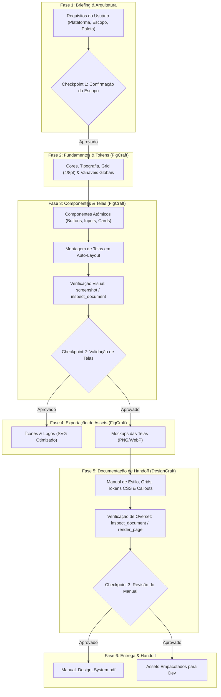

# ArtCraft: Frontend, UI/UX & Design Systems
### Pipeline Integrado com FigCraft & DesignCraft via MCP

Esta skill fornece um protocolo rigoroso, modular e explicativo para guiar agentes de IA na concepção, prototipagem, estilização e documentação de interfaces digitais completas para Web e Mobile.

---

## 1. Matriz de Ferramentas e Papéis no Pipeline

| Aplicativo | Papel no Pipeline | Formatos Nativos / Exportados | Modo de Execução MCP | Equivalente de Mercado |
| :--- | :--- | :--- | :--- | :--- |
| **FigCraft** | Criação de wireframes, layouts responsivos, sistemas atômicos de componentes, variantes de estado, design tokens e exportação de assets vetoriais e rasterizados. | `.figcraft`, `.svg`, `.png`, `.jpg`, `.pdf` | Headless (motor de nós) / Bridge (live UI) | Figma / Sketch |
| **DesignCraft** | Diagramação de guias de estilo de alta precisão, documentação técnica de handoff para desenvolvedores, manuais de Design System e especificações de tokens CSS. | `.designcraft`, `.pdf`, `.png` | Headless (motor editorial) / Bridge (live UI) | Adobe InDesign / QuarkXPress |

---

## 2. Convenções Técnicas e Sistemas de Coordenadas

### FigCraft (`figcraft`)
- **Unidades & Orientação:** 1 unidade = 1 pixel virtual (a 100% de zoom). Origem `(0, 0)` no canto superior esquerdo da página, com $X$ crescendo para a direita e $Y$ crescendo para baixo.
- **Hierarquia Relativa:** Os comandos `create_node` e `set_properties` recebem coordenadas $X$ e $Y$ **relativas ao container pai** (o frame pai). Apenas quando não há pai (nó solto na raiz) as coordenadas correspondem ao espaço global da página.
- **Auto-Layout:** Quando um frame possui auto-layout ativo, os nós filhos são posicionados automaticamente pelo layout. Não use coordenadas manuais $X/Y$; em vez disso, ajuste `layout` (`"horizontal"` / `"vertical"`), `gap`, `padding` (`[top, right, bottom, left]`), `mainAlign`, `crossAlign`, `sizingH` (`"hug"` / `"fill"` / `"fixed"`) e `sizingV`.
- **Cores:** Notação hexadecimal estrita em formato de string, e.g., `"#3B82F6"` ou com canal alfa `"#3B82F6CC"`.
- **Nomenclatura Semântica:** Adote rigorosamente a convenção com barras para agrupamento: `Category/Component-Name/Variant` (ex.: `Button/Primary/Default`, `Navbar/Desktop/Default`, `Card/Product/Compact`).

### DesignCraft (`designcraft`)
- **Unidades & Espaço de Espalhamento (Spread):** Coordenadas em **pontos tipográficos** ($1\text{ pt} = 1/72\text{ polegadas}$). Em uma página única, o topo esquerdo é `(0, 0)`. Uma folha Letter mede $612 \times 792\text{ pt}$; uma página A4 mede aproximadamente $595 \times 842\text{ pt}$.
- **Caixas de Texto e Overset:** Caixas de texto criadas com `frame.create` contêm histórias (`stories`). Sempre verifique se o texto excede o limite da caixa inspecionando o campo `overset` retornado por `inspect_document`.

---

## 3. Fluxo de Trabalho Integrado (Pipeline Visual)



---

## 4. Roadmap de Criação de Conteúdo: Passo a Passo

### 🎯 FASE 1: Briefing, Alinhamento de Plataforma & Arquitetura
**Objetivo:** Obter clareza total dos requisitos visuais, técnicos e funcionais antes de iniciar qualquer desenho vetorial.

- **Ferramentas MCP a Utilizar:** Não há chamadas MCP estruturantes nesta fase; realize a leitura e inspeção de eventuais arquivos já fornecidos no projeto com comandos do sistema de arquivos.
- **Perguntas Obrigatórias ao Usuário (Checkpoints):**
  1. *Plataforma e Resolução:* "Qual é a plataforma prioritária? Mobile (ex.: iOS 390x844 ou Android 360x800) ou Web Desktop (ex.: 1440x900 / 1920x1080)?"
  2. *Design System & Identidade:* "Já existe uma paleta de cores institucional, logo ou tipografia definida, ou devo propor um guia cromático e tipográfico moderno?"
  3. *Tema e Estilo:* "Deseja tema Claro (Light), Escuro (Dark) ou ambos com suporte a tokens alternáveis?"
  4. *Escopo de Telas:* "Quais são as telas essenciais que devemos cobrir neste fluxo (ex.: Onboarding, Dashboard, Detalhe do Produto, Checkout)?"
- **Quality Gate 1:** Somente avance para a Fase 2 após receber ou fixar as respostas das perguntas acima.

---

### 🎨 FASE 2: Fundamentos & Design Tokens no FigCraft
**Objetivo:** Estabelecer a base cromática, tipográfica e de espaçamentos no FigCraft como elementos reutilizáveis.

- **Ferramentas MCP a Utilizar:**
  - `figcraft: create_node` (criar frame de documentação ou biblioteca de tokens).
  - `figcraft: set_properties` (definir variáveis de cores, fill, stroke, estilos de texto).
  - `figcraft: list_commands` / `figcraft: run_command` (para aplicar tokens globais).
- **Ações Detalhadas:**
  1. Defina a escala cromática semântica:
     - `brand-primary` (cor de ação principal).
     - `brand-secondary` (apoio visual e destaques).
     - `surface-background`, `surface-card`, `surface-elevated` (planos de fundo).
     - `text-primary`, `text-secondary`, `text-muted` (legibilidade tipográfica).
     - `status-success`, `status-warning`, `status-danger`.
  2. Defina a escala tipográfica baseada em proporção harmônica (Major Third $1.25$ ou Perfect Fourth $1.33$):
     - `Display` ($32\text{px}$ a $40\text{px}$, Bold), `H1` ($24\text{px}$ a $28\text{px}$, Bold), `H2` ($20\text{px}$ a $22\text{px}$, SemiBold), `Body` ($14\text{px}$ a $16\text{px}$, Regular), `Caption` ($12\text{px}$, Regular).
  3. Adote o grid de espaçamento modular baseado em múltiplos de $4\text{px}$ ou $8\text{px}$ (`4px`, `8px`, `16px`, `24px`, `32px`, `48px`).
- **Quality Gate 2:** Verifique se as cores atendem ao contraste mínimo de acessibilidade WCAG AA ($4.5:1$ para texto normal e $3:1$ para texto grande ou ícones interativos).

---

### 🧩 FASE 3: Componentes Atômicos & Montagem de Telas no FigCraft
**Objetivo:** Desenvolver componentes reutilizáveis e estruturar as telas do fluxo com auto-layout e responsividade.

- **Ferramentas MCP a Utilizar:**
  - `figcraft: create_node` (criar nós do tipo `"frame"`, `"rectangle"`, `"text"`, `"vector"`).
  - `figcraft: set_properties` (definir padding, gap, layout, border-radius, alinhamento).
  - `figcraft: select` / `figcraft: batch` (executar criação e estilização em lote com atomicidade).
  - `figcraft: inspect_document` (validar estrutura da árvore de nós, tamanhos absolutos e relativos).
  - `figcraft: screenshot` (gerar visualização gráfica do frame ou componente montado).
- **Ações Detalhadas:**
  1. *Componentes Base:*
     - Botões com auto-layout horizontal: padding horizontal de `16px` a `24px`, vertical de `10px` a `14px`, `gap: 8px` entre ícone e texto.
     - Inputs de formulário: altura fixa de `44px` a `48px` (área de toque ergonômica), bordas suaves (`radius: 8px`), placeholders contrastantes.
     - Cards de conteúdo: auto-layout vertical, padding de `16px`, background contrastante, elevação suave com sombra ou borda de `1px`.
  2. *Estruturação de Telas:*
     - Crie o frame raiz com a resolução exata (ex.: `390x844` ou `1440x900`).
     - Divida a tela em seções nomeadas: `Header`, `Hero_Section`, `Main_Content`, `Bottom_Nav_Bar` ou `Footer`.
     - Encadeie os componentes dentro de frames de auto-layout para garantir escalabilidade responsiva.
- **Verificações Necessárias (Quality Gate 3):**
  - Chame `figcraft: inspect_document` e assegure que não há nós soltos com coordenadas negativas ou fora dos limites do frame.
  - Chame `figcraft: screenshot` com o `id` do frame raiz e inspecione a imagem para confirmar hierarquia visual, alinhamento e clareza.
- **Pergunta ao Usuário durante a Etapa (Checkpoint 2):**
  - "Gerei a estrutura inicial e a pré-visualização das telas [Nome das Telas]. A hierarquia dos elementos e a distribuição visual atendem às suas expectativas ou deseja ajustes de layout antes de prosseguirmos para o handoff?"

---

### 📦 FASE 4: Exportação de Assets para Engenharia Frontend
**Objetivo:** Gerar e salvar os arquivos de arte finais nos formatos adequados para uso direto por desenvolvedores.

- **Ferramentas MCP a Utilizar:**
  - `figcraft: export` (exportação de nós selecionados em formatos gráficos).
- **Diretrizes de Formato:**
  - **Ícones, Ilustrações Vetoriais e Logotipos:** Exporte estritamente como `.svg` otimizado (com caminhos limpos, sem preenchimentos desnecessários e com viewbox correta).
  - **Fotografias e Imagens Complexas:** Exporte em `.png` com transparência ou `.webp` de alta fidelidade.
  - **Mockups de Tela Inteira:** Exporte em `.png` com fator de escala `@2x` para compor o manual técnico de documentação.
- **Organização em Disco:**
  - Salve os assets em diretórios claros relativos ao projeto, e.g., `./design-assets/icons/` e `./design-assets/screens/`.

---

### 📖 FASE 5: Documentação de Handoff & Design System no DesignCraft
**Objetivo:** Diagramar um documento de especificações técnicas elegante, claro e navegável para a equipe de engenharia.

- **Ferramentas MCP a Utilizar:**
  - `designcraft: new_document` (inicializar documento de layout, ex.: Letter ou A4).
  - `designcraft: execute` com comando `frame.create` (criar caixas de texto e frames de imagens).
  - `designcraft: place_image` (inserir os mockups PNG exportados pelo FigCraft).
  - `designcraft: set_story_text` (preencher tabelas de tokens, diretrizes e regras de UX).
  - `designcraft: execute` com estilos de parágrafo (`style.paragraph.apply`).
  - `designcraft: inspect_document` (verificar se há texto oculto por estouro de caixa).
  - `designcraft: render_page` (renderizar página para conferência gráfica).
- **Estrutura Recomendada do Manual:**
  - **Página 1 (Capa):** Título do Produto, Versão do Design System, Data e Autores.
  - **Página 2 (Tokens de Design):** Amostras visuais de cores com seus códigos HEX, nomes de variáveis CSS (`--color-primary: #3B82F6;`), escala tipográfica com `font-family`, `font-size` e `line-height`.
  - **Página 3 em diante (Especificação de Telas):** Imagem do mockup à esquerda/centro e anotações técnicas à direita:
    - Espaçamentos em pixels.
    - Estados interativos dos componentes (Default, Hover, Focus, Active, Disabled).
    - Regras de quebra responsiva (Breakpoints: Mobile $< 768\text{px}$, Tablet $768-1024\text{px}$, Desktop $> 1024\text{px}$).
- **Verificações Necessárias (Quality Gate 4):**
  - Execute `designcraft: inspect_document` e inspecione a propriedade `overset` de cada história. Se `overset: true`, aumente a altura do frame ou reduza o tamanho da fonte para que nenhuma especificação seja truncada.
  - Execute `designcraft: render_page` na página 1 e página 2 para certificar-se da elegância do grid e da legibilidade das anotações.

---

### 🚀 FASE 6: Quality Gate Final & Entrega
**Objetivo:** Gerar o PDF consolidado e entregar os entregáveis organizados.

- **Ferramentas MCP a Utilizar:**
  - `designcraft: save_document` (salvar o arquivo de projeto `.designcraft`).
  - `designcraft: export_png` ou comando de exportação para PDF de alta resolução.
- **Pergunta ao Usuário (Checkpoint Final):**
  - "O manual de Design System e handoff foi gerado com sucesso em [Caminho do Arquivo], juntamente com os assets em SVG/PNG. Gostaria de adicionar especificações de animações/microinterações ou exportar variações adicionais de componentes?"

---

## 5. Dicionário de Ferramentas MCP & Exemplos Práticos

### FigCraft: Criação de Tela e Componente
```json
// 1. Criar Frame de Tela Mobile (iPhone)
{
  "tool": "figcraft:create_node",
  "arguments": {
    "type": "frame",
    "name": "Screen/HomeScreen",
    "x": 0,
    "y": 0,
    "width": 390,
    "height": 844
  }
}

// 2. Configurar Propriedades de Background e Layout
{
  "tool": "figcraft:set_properties",
  "arguments": {
    "id": "<id_do_frame>",
    "fills": [{"type": "solid", "color": "#F8FAFC"}],
    "layout": "vertical",
    "padding": [24, 20, 24, 20],
    "gap": 16
  }
}

// 3. Capturar Screenshot de Validação
{
  "tool": "figcraft:screenshot",
  "arguments": {
    "nodeId": "<id_do_frame>"
  }
}
```

### DesignCraft: Criação de Caixa e Inserção de Imagem
```json
// 1. Criar novo documento A4
{
  "tool": "designcraft:new_document",
  "arguments": {
    "preset": "A4",
    "facingPages": false
  }
}

// 2. Criar moldura para mockup de tela
{
  "tool": "designcraft:execute",
  "arguments": {
    "command": "frame.create",
    "params": {
      "rect": [40, 80, 260, 480],
      "content": "graphic"
    }
  }
}

// 3. Inserir imagem exportada do FigCraft
{
  "tool": "designcraft:place_image",
  "arguments": {
    "frameId": "<id_da_moldura>",
    "filePath": "design-assets/screens/HomeScreen.png"
  }
}

// 4. Renderizar página para inspecionar
{
  "tool": "designcraft:render_page",
  "arguments": {
    "pageIndex": 0
  }
}
```

---

## 6. Tratamento de Erros e Resolução de Problemas (Troubleshooting)

| Sintoma / Erro | Causa Provável | Solução Recomendada |
| :--- | :--- | :--- |
| **Nó filho aparece fora do frame no FigCraft** | Coordenadas passadas como absolutas em vez de relativas ao pai. | Lembre-se de que `x` e `y` em `create_node` são relativos à borda superior esquerda do nó pai. Defina `x: 0, y: 0` para alinhar ao canto do container. |
| **Filho não respeita `x` e `y` definidos** | O frame pai está com auto-layout ativo. | Em auto-layout, a posição é governada pelas regras de alinhamento (`mainAlign`, `crossAlign`) e ordem dos nós. Remova as coordenadas manuais e ordene os nós logicamente. |
| **Texto cortado no DesignCraft (`overset: true`)** | O volume de texto da especificação ultrapassou a altura da caixa. | Chame `inspect_document`, identifique a caixa com `overset: true` e aumente a dimensão vertical via `frame.set_bounds` ou divida o texto em duas caixas encadeadas. |
| **Erro de permissão de arquivo (`Path refused`)** | Caminho fora do diretório raiz concedido no lançamento do MCP. | Utilize apenas caminhos relativos ao diretório do workspace configurado nas flags `--automation-read-root` e `--automation-write-root`. |
