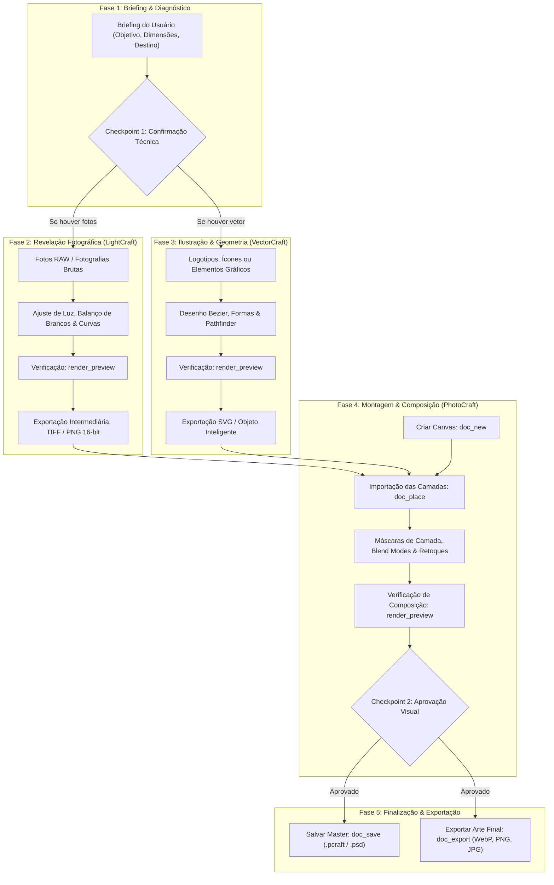

# ArtCraft: Imagem, Fotografia & Ilustração
### Pipeline Integrado com LightCraft, PhotoCraft & VectorCraft via MCP

Esta skill fornece uma metodologia rigorosa, estruturada e detalhada para guiar agentes de IA em todo o fluxo de produção de imagens digitais estáticas — desde o tratamento fotográfico em nível RAW e criação vetorial até a montagem final em camadas e exportação profissional.

---

## 1. Matriz de Ferramentas e Papéis no Pipeline

| Aplicativo | Papel no Pipeline | Formatos Nativos / Exportados | Modo de Execução MCP | Equivalente de Mercado |
| :--- | :--- | :--- | :--- | :--- |
| **LightCraft** | Revelação não-destrutiva de fotos, controle fino de exposição, contraste, balanço de brancos (temperatura/matiz), correção de lentes, curvas tonais e recorte em proporções padrão. | RAW, DNG, TIFF, JPEG, PNG | Headless (in-process engine) | Adobe Lightroom / Capture One |
| **VectorCraft** | Desenho vetorial de alta precisão, criação de logotipos, ícones, formas geométricas, tipografia estilizada, traçados Bezier e operações booleanas de corte/união. | `.vectorcraft`, `.svg`, `.pdf`, `.ai` | Headless (in-process engine) | Adobe Illustrator / CorelDraw |
| **PhotoCraft** | Edição raster avançada, composição em múltiplas camadas, máscaras de recorte, remoção de manchas/imperfeições, modos de mesclagem (blend modes), filtros e fotomontagens. | `.pcraft`, `.psd`, `.png`, `.jpg`, `.webp` | Headless (in-process engine) / Bridge (live UI) | Adobe Photoshop / Affinity Photo |

---

## 2. Convenções Técnicas e Sistemas de Coordenadas

### LightCraft (`lightcraft`)
- **Espaço de Coordenadas:** Valores normalizados no intervalo $[0.0, 1.0]$, onde $(0, 0)$ é o canto superior esquerdo da foto e $(1, 1)$ é o canto inferior direito.
- **Parâmetros de Revelação (`develop.set`):**
  - Luz: `light.exposure` (EV, e.g. `+0.5`), `light.contrast` ($-1.0$ a $+1.0$), `light.highlights` (recuperação de altas luzes), `light.shadows` (abertura de sombras), `light.whites`, `light.blacks`.
  - Cor: `color.temperature` (Kelvin), `color.tint` (verde/magenta), `color.vibrance`, `color.saturation`.
  - Detalhe: `detail.sharpening`, `detail.noise_reduction`.
- **Modo Não-Destrutivo:** Os ajustes não sobrescrevem a foto original; a renderização para formato intermediário (`.png` ou `.tif` 16-bit) preserva a gama de cores antes da composição.

### VectorCraft (`vectorcraft`)
- **Espaço do Documento:** Pontos tipográficos ($1\text{ pt} = 1/72\text{ polegadas}$). Origem $(0, 0)$ no canto superior esquerdo da prancheta principal. Documento padrão: $612 \times 792\text{ pt}$.
- **Pintura e Preenchimento (`set_paint`):** Propriedades `fill` e `stroke` aceitam valores hexadecimais (`"#HEX"`), gradientes ou `"none"`. A espessura do traço é governada por `strokeWidth`.
- **Operações Booleanas (`pathfinder`):** `union` (fundir), `subtract` (subtrair frente), `intersect` (interseção) e `exclude` (excluir sobreposição).

### PhotoCraft (`photocraft`)
- **Espaço de Coordenadas:** Pixels inteiros absolutos baseados nas dimensões da tela de pintura (`canvas`).
- **Pilha de Camadas:** Camadas são indexadas e nomeadas. Elementos externos inseridos com `doc_place` podem ser convertidos em Objetos Inteligentes (*Smart Objects*), permitindo transformações não-destrutivas.
- **Histórico:** Cada comando executado via `command_run` ou `command_batch` gera um passo no histórico de desfazer (`undo`).

---

## 3. Fluxo de Trabalho Integrado (Pipeline Visual)



---

## 4. Roadmap de Criação de Conteúdo: Passo a Passo

### 🎯 FASE 1: Briefing, Alinhamento Técnico & Diagnóstico de Ativos
**Objetivo:** Estabelecer o propósito visual, especificações de saída e verificar os ativos brutos disponíveis.

- **Ferramentas MCP a Utilizar:**
  - `lightcraft: query_photos` (listar fotos disponíveis na biblioteca).
  - Comandos do sistema de arquivos para inspecionar mídias na pasta de trabalho.
- **Perguntas Obrigatórias ao Usuário (Checkpoints):**
  1. *Finalidade & Destino da Imagem:* "Esta peça será utilizada em mídias digitais (ex.: banner de website, post do Instagram, capa de anúncio) ou material impresso (ex.: cartaz, catálogo, embalagem)?"
  2. *Dimensões & Resolução:* "Qual a proporção de tela ou resolução exata necessária? (ex.: 1080x1080 para post quadrado, 1920x1080 para banner Full HD, ou 300 DPI em dimensões de impressão)?"
  3. *Paleta & Atmosfera:* "Há alguma orientação de cor específica (tons quentes, neutros frios, estilo cyberpunk, minimalista clean) ou paleta da marca?"
  4. *Elementos Gráficos Obrigatórios:* "É necessário incluir logotipo, tipografia, slogan ou grafismos vetoriais específicos?"
- **Quality Gate 1:** Confirmação do destino, dimensões de pixel/DPI e lista de elementos a produzir.

---

### ☀️ FASE 2: Revelação e Tratamento Fotográfico no LightCraft
**Objetivo:** Calibrar a fotografia para atingir equilíbrio tonal perfeito e ampla latitude antes da manipulação em camadas.

- **Ferramentas MCP a Utilizar:**
  - `lightcraft: query_photos` (localizar o ID da foto).
  - `lightcraft: select_photos` (tornar a foto ativa).
  - `lightcraft: set_develop` (aplicar valores de revelação).
  - `lightcraft: render_preview` (inspecionar o resultado do tratamento).
  - `lightcraft: crop` (recortar na proporção adequada, se necessário).
  - `lightcraft: export` (gerar o arquivo intermediário sem perdas).
- **Ações Detalhadas:**
  1. Corrija o balanço de brancos para remover dominantes de cor indesejadas (`color.temperature` e `color.tint`).
  2. Ajuste o alcance dinâmico:
     - Se o fundo estiver estourado, reduza `light.highlights` (ex.: `-0.4`).
     - Se as áreas de interesse estiverem escuras, abra `light.shadows` (ex.: `+0.35`).
     - Defina o ponto de preto com `light.blacks` para garantir profundidade de contraste.
  3. Aplique `color.vibrance` com parcimônia para intensificar tons suaves sem saturar peles humanas.
- **Verificações Necessárias (Quality Gate 2):**
  - Chame `lightcraft: render_preview` e avalie se há áreas de sombra empastadas (sem detalhe) ou altas luzes com corte (*clipping*).
  - Exporte em formato sem perdas (`.png` de alta resolução ou `.tif`) para uso no PhotoCraft.

---

### 🖋️ FASE 3: Criação Vetorial e Elementos Gráficos no VectorCraft
**Objetivo:** Desenhar logotipos, grafismos, ícones ou molduras vetoriais que comporão a arte final.

- **Ferramentas MCP a Utilizar:**
  - `vectorcraft: draw_shape` (retângulos, elipses, polígonos).
  - `vectorcraft: draw_path` (traçados complexos via comandos SVG path `M`, `C`, `L`, `Z`).
  - `vectorcraft: set_paint` (configuração de preenchimento `fill` e contorno `stroke`).
  - `vectorcraft: pathfinder` (operações booleanas de união e recorte).
  - `vectorcraft: add_text` (inserção de tipografia vetorial).
  - `vectorcraft: render_preview` (conferência visual do vetor).
  - `vectorcraft: export` (exportar em `.svg`).
- **Ações Detalhadas:**
  1. Crie os elementos principais utilizando formas geométricas primárias combinadas via `pathfinder`.
  2. Assegure que os traçados estejam fechados e limpos (sem nós duplicados).
  3. Para logos e selos, alinhe geometricamente com margens uniformes.
- **Verificações Necessárias (Quality Gate 3):**
  - Chame `vectorcraft: render_preview` para validar curvas, alinhamentos e espessuras de contorno.
  - Exporte o arquivo como `.svg` para inserção como Objeto Inteligente no PhotoCraft.

---

### 🖼️ FASE 4: Montagem, Composição & Retoque no PhotoCraft
**Objetivo:** Montar a composição final integrando foto revelada, vetores, textos e tratamentos de pintura digital.

- **Ferramentas MCP a Utilizar:**
  - `photocraft: doc_new` (criar novo documento com largura, altura e resolução definidas).
  - `photocraft: doc_place` (inserir foto do LightCraft e vetor do VectorCraft).
  - `photocraft: command_run` / `photocraft: command_batch` (criar camadas, aplicar modos de mesclagem, opacidades, filtros).
  - `photocraft: doc_inspect` (verificar hierarquia e propriedades de camadas).
  - `photocraft: render_preview` (inspecionar o resultado composto).
- **Ações Detalhadas:**
  1. *Inicialização do Documento:* Execute `doc_new` passando largura, altura e espaço de cor (RGB para tela, CMYK para impressão).
  2. *Organização da Pilha de Camadas:*
     - Camada inferior: `Background_Photo` (imagem importada via `doc_place`).
     - Camadas intermediárias: `VFX_Gradient_Overlay` (gradiente para criar contraste), `Product_Subject` ou `Model_Cutout`.
     - Camada superior: `Graphic_Elements` e `Logo_Vector` (vetores inseridos do VectorCraft).
     - Camadas de texto: títulos e chamadas principais.
  3. *Retoque e Ajustes Finos:*
     - Crie máscaras de recorte suaves para fundir a foto ao plano de fundo.
     - Ajuste curvas de iluminação globais para que todos os elementos pareçam pertencer à mesma cena luminosa.
- **Verificações Necessárias (Quality Gate 4):**
  - Chame `photocraft: render_preview` e inspecione a imagem em tamanho real.
  - Verifique: Não há bordas duras ou halos brancos em recortes; a tipografia possui contraste perfeito contra o fundo; os elementos vetoriais mantêm nitidez impecável.
- **Pergunta ao Usuário durante a Etapa (Checkpoint 2):**
  - "Gerei a composição preliminar da imagem em [Caminho da Imagem/Preview]. O equilíbrio entre a fotografia, a iluminação e os grafismos vetoriais está alinhado com o seu objetivo ou prefere ajustes na saturação, enquadramento ou posicionamento dos elementos?"

---

### 💾 FASE 5: Quality Gate Final, Arquivamento & Exportação
**Objetivo:** Salvar o arquivo mestre com camadas preservadas e exportar os arquivos de entrega final otimizados para produção.

- **Ferramentas MCP a Utilizar:**
  - `photocraft: doc_save` (salvar o projeto nativo `.pcraft` ou `.psd` com todas as camadas intactas).
  - `photocraft: doc_export` (exportar imagens achatadas nos formatos requeridos).
- **Formatos Recomendados por Caso de Uso:**
  - **Web / Redes Sociais:** `.webp` (compressão de alta eficiência sem perda visível) ou `.jpg` (qualidade 85-90%).
  - **Assets Transparentes / Banners:** `.png` de 24-bits com canal alfa limpo.
  - **Material Impresso:** `.tif` sem compressão ou `.pdf` de impressão com marcas de corte e 300 DPI.
  - **Arquivo Mestre Editável:** Sempre salve `.pcraft` ou `.psd` no repositório de trabalho.
- **Verificação de Disco:** Confirme a existência e integridade do arquivo gerado via `Get-Item`.

---

## 5. Dicionário de Ferramentas MCP & Exemplos Práticos

### LightCraft: Ajuste de Revelação
```json
// Ajustar Exposição, Sombras e Balanço de Brancos
{
  "tool": "lightcraft:set_develop",
  "arguments": {
    "photoId": 1,
    "values": {
      "light.exposure": 0.45,
      "light.shadows": 0.30,
      "light.highlights": -0.25,
      "color.temperature": 5400,
      "color.vibrance": 0.15
    }
  }
}
```

### VectorCraft: Desenhar Formas e Exportar SVG
```json
// 1. Criar forma com contorno e preenchimento
{
  "tool": "vectorcraft:draw_shape",
  "arguments": {
    "type": "rounded_rect",
    "x": 50,
    "y": 50,
    "width": 200,
    "height": 100,
    "radius": 12
  }
}

// 2. Definir estilo de cor
{
  "tool": "vectorcraft:set_paint",
  "arguments": {
    "fill": "#2563EB",
    "stroke": "#1E40AF",
    "strokeWidth": 2
  }
}

// 3. Exportar para SVG
{
  "tool": "vectorcraft:export",
  "arguments": {
    "format": "svg",
    "outputPath": "assets/badge_logo.svg"
  }
}
```

### PhotoCraft: Criação de Documento e Composição
```json
// 1. Criar canvas de alta resolução para Web
{
  "tool": "photocraft:doc_new",
  "arguments": {
    "width": 1920,
    "height": 1080,
    "resolution": 72,
    "colorMode": "rgb"
  }
}

// 2. Inserir a imagem revelada do LightCraft
{
  "tool": "photocraft:doc_place",
  "arguments": {
    "filePath": "assets/photo_developed.png",
    "asSmartObject": true
  }
}

// 3. Gerar pré-visualização para checagem
{
  "tool": "photocraft:render_preview",
  "arguments": {}
}

// 4. Salvar Master e Exportar
{
  "tool": "photocraft:doc_save",
  "arguments": {
    "filePath": "banners/hero_final.pcraft"
  }
}
```

---

## 6. Tratamento de Erros e Resolução de Problemas (Troubleshooting)

| Sintoma / Erro | Causa Provável | Solução Recomendada |
| :--- | :--- | :--- |
| **Imagem exportada com cores opacas ou desbotadas** | Conflito de perfil de cor (documento criado em CMYK e visualizado em navegador RGB). | Certifique-se de definir `colorMode: "rgb"` com perfil sRGB para entregas digitais web/mobile. |
| **Bordas serrilhadas ou halo branco ao recortar foto** | Máscara de camada com transição abrupta ou sem suavização (*feathering*). | Aplique um desfoque gaussiano de $0.5\text{px}$ a $1.0\text{px}$ na máscara de camada antes de exportar. |
| **Vetor perde resolução ou fica pixelado no PhotoCraft** | Vetor inserido como raster direto em baixa resolução. | Insira o arquivo vetorial com `asSmartObject: true` em `doc_place` para preservar escalabilidade infinita. |
| **Caminho de arquivo recusado (`automation root`)** | Caminho absoluto fora da pasta de trabalho autorizada. | Use sempre caminhos relativos ao diretório raiz de execução concedido no MCP. |
