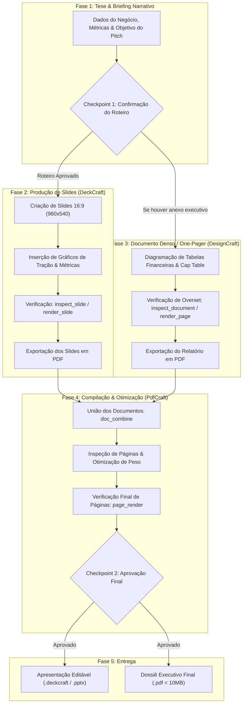

# ArtCraft: Pitch Decks, Apresentações & Documentos Executivos
### Pipeline Integrado com DeckCraft, DesignCraft & PdfCraft via MCP

Esta skill fornece um roteiro estratégico, rigoroso e analítico para conduzir agentes de IA em todas as etapas da criação de apresentações de alto impacto e materiais executivos prontos para reuniões de investimento e diretoria.

---

## 1. Matriz de Ferramentas e Papéis no Pipeline

| Aplicativo | Papel no Pipeline | Formatos Nativos / Exportados | Modo de Execução MCP | Equivalente de Mercado |
| :--- | :--- | :--- | :--- | :--- |
| **DeckCraft** | Estruturação de narrativa em slides, roteirização, aplicação de layouts 16:9, gráficos estatísticos de barras/linhas, caixas de destaque de métricas e síntese visual limpa. | `.deckcraft`, `.pptx`, `.pdf` | Headless (in-process engine) | Microsoft PowerPoint / Google Slides |
| **DesignCraft** | Diagramação de alta precisão tipográfica para documentos executivos densos: one-pagers, relatórios anuais, demonstrativos de resultados (DRE), balanços e sumários executivos. | `.designcraft`, `.pdf`, `.png` | Headless (in-process engine) / Bridge (live UI) | Adobe InDesign / QuarkXPress |
| **PdfCraft** | Compilação final de documentos, união (`combine`/`merge`) de decks com relatórios, reordenação de páginas, verificação de orientação de páginas e otimização de tamanho de arquivo. | `.pdf` | Headless (in-process engine) | Adobe Acrobat Pro |

---

## 2. Convenções Técnicas e Sistemas de Coordenadas

### DeckCraft (`deckcraft`)
- **Espaço de Coordenadas:** Pontos tipográficos em tela widescreen 16:9 padrão ($960 \times 540\text{ pt}$). A origem $(0, 0)$ está no canto superior esquerdo do slide ativo. $X$ cresce para a direita e $Y$ cresce para baixo.
- **Hierarquia de Objetos:** Cada elemento inserido (`add_shape`, `add_text_box`, `insert_picture`, `insert_chart`) recebe um identificador único (`id`) no escopo do slide corrente.
- **Seleção e Formatação:** Ações de estilo (`format.*`, `shape.fill`, `shape.line`) atuam sobre os objetos selecionados ou sobre a lista explícita de `ids` informada.
- **Inspeção e Verificação:** `inspect_slide` retorna a árvore completa de nós, caixas delimitadoras (*bounding boxes*) e textos contidos; `render_slide` gera um arquivo PNG de alta fidelidade para validação visual.

### DesignCraft (`designcraft`)
- **Espaço do Documento:** Pontos em spread editorial ($612 \times 792\text{ pt}$ para formato Carta / Letter ou $595 \times 842\text{ pt}$ para A4).
- **Inspeção de Histórias:** Verifique sempre o atributo `overset` retornado por `inspect_document` para garantir que textos de notas financeiras ou descrições não tenham sido truncados pelo limite da caixa de texto.

### PdfCraft (`pdfcraft`)
- **Numeração de Páginas:** Indexação baseada em $1$ (a primeira página é a página 1).
- **Inspeção de Metadados:** `doc_info` retorna contagem total de páginas, dimensões de cada folha, orientação (retrato ou paisagem) e versão de conformidade do PDF.

---

## 3. Fluxo de Trabalho Integrado (Pipeline Visual)



---

## 4. Roadmap de Criação de Conteúdo: Passo a Passo

### 🎯 FASE 1: Briefing Executivo, Definição de Tese & Roteiro
**Objetivo:** Compreender a audiência-alvo, a meta de captação/venda e estruturar a linha narrativa antes de criar qualquer slide.

- **Ferramentas MCP a Utilizar:** Checagem e leitura de notas ou planilhas financeiras fornecidas no projeto com ferramentas de leitura de arquivo.
- **Perguntas Obrigatórias ao Usuário (Checkpoints):**
  1. *Audiência & Objetivo:* "Este pitch é para investidores de risco (Venture Capital / Anjos), apresentação comercial B2B para clientes ou relatório para o conselho/board?"
  2. *Métricas & Dados Essenciais:* "Quais são os principais números de tração a destacar (ex.: MRR, ARR, taxa de crescimento MoM, CAC, LTV, churn, volume transacionado)?"
  3. *Tamanho da Rodada & The Ask:* "Qual é o valor pretendido de captação (The Ask) e qual a distribuição planejada do capital (ex.: 50% produto, 30% vendas/mkt, 20% operações)?"
  4. *Identidade & Paleta:* "Possui cores institucionais e logotipo prontos, ou devo aplicar uma paleta corporativa moderna de alto contraste?"
- **Estrutura Canônica de 10 a 12 Slides de Pitch Deck:**
  1. **Capa / Title:** Nome da Startup, Tagline clara e impactante, dados de contato e logotipo.
  2. **Problema:** A dor crítica e validada vivenciada pelo cliente no mercado atual.
  3. **Solução:** Como o seu produto resolve a dor de forma $10\times$ mais rápida, barata ou eficiente.
  4. **Demonstração / Produto:** Visual da plataforma, fluxo principal de uso e proposição de valor.
  5. **Tamanho de Mercado:** TAM (Total Addressable), SAM (Serviceable Addressable) e SOM (Serviceable Obtainable).
  6. **Modelo de Negócios:** Como a empresa monetiza (SaaS, comissão por transação, licenciamento).
  7. **Tração & Validação:** Gráfico de crescimento acelerado, principais marcos alcançados e depoimentos de grandes clientes.
  8. **Go-to-Market (GTM):** Estratégia de aquisição, canais de distribuição e ciclo de vendas.
  9. **Cenário Competitivo:** Matriz $2 \times 2$ demonstrando a diferenciação clara perante concorrentes diretos e indiretos.
  10. **Equipe Fundadora:** Sócios-chave, experiências prévias relevantes e histórico de realizações.
  11. **Projeções Financeiras:** Gráfico de projeção para 3 anos e metas de *breakeven*.
  12. **The Ask / Captação:** Valor da rodada, alocação de recursos e próximos marcos a atingir em 18 meses.
- **Quality Gate 1:** O usuário deve validar a sequência dos tópicos e os dados numéricos antes de iniciarmos a montagem no DeckCraft.

---

### 📊 FASE 2: Produção de Slides no DeckCraft
**Objetivo:** Montar os slides no padrão 16:9 widescreen com forte impacto visual, clareza tipográfica e dados visualmente digestíveis.

- **Ferramentas MCP a Utilizar:**
  - `deckcraft: new_presentation` (iniciar apresentação no formato 16:9).
  - `deckcraft: add_slide` (adicionar slide com layout específico, título e corpo).
  - `deckcraft: add_shape` / `deckcraft: add_text_box` (inserir cartões de métricas e elementos visuais).
  - `deckcraft: insert_chart` (inserir gráficos de tração em barras ou linhas).
  - `deckcraft: insert_picture` (inserir logotipos e prints do produto).
  - `deckcraft: inspect_slide` (ler a árvore de elementos e verificar posições).
  - `deckcraft: render_slide` (renderizar PNG do slide para verificação visual).
- **Regras de Design e Ergonomia Visual:**
  - **Regra do 6x6:** No máximo 6 tópicos por slide e no máximo 6 palavras por linha. Evite parágrafos densos; use frases nominais diretas.
  - **Estatísticas em Destaque:** Para métricas importantes, utilize tipografia gigante ($40\text{pt}$ a $56\text{pt}$) acompanhada de legenda concisa ($14\text{pt}$), ex.: `+240% YoY` ou `\$1.2M ARR`.
  - **Paleta Restrita:** Use uma cor de fundo limpa (branco puro ou cinza suave `#F8FAFC`), uma cor primária corporativa marcante (ex.: azul `#1D4ED8` ou verde esmeralda `#059669`) e uma cor de acento de alto contraste para focar a atenção nos números.
- **Verificações Necessárias (Quality Gate 2):**
  - Chame `deckcraft: inspect_slide` para assegurar que não haja sobreposição de caixas de texto.
  - Chame `deckcraft: render_slide` em cada slide fundamental (Capa, Problema, Solução, Tração, The Ask) e examine a legibilidade de longe.

---

### 📑 FASE 3: Diagramação de Anexo Executivo / One-Pager no DesignCraft
**Objetivo:** Criar material complementar de aprofundamento (One-Pager ou Memorando Técnico) com tabelas financeiras completas.

- **Ferramentas MCP a Utilizar:**
  - `designcraft: new_document` (formato A4 ou Letter).
  - `designcraft: execute` com comando `frame.create` (criar grids de colunas e caixas de texto).
  - `designcraft: set_story_text` (inserir demonstrativos financeiros, termos e cronogramas).
  - `designcraft: inspect_document` (verificar se há `overset` de texto).
  - `designcraft: render_page` (renderizar a página para inspeção visual).
- **Ações Detalhadas:**
  1. Estruture a página em um grid de 2 ou 3 colunas para leitura rápida.
  2. Crie uma seção destacada para "Destaques Operacionais e Financeiros" com tabela de margens (Gross Margin, EBITDA).
  3. Insira notas de rodapé legais e cláusulas de confidencialidade (*Strictly Confidential*).
- **Quality Gate 3:** Confirme que `inspect_document` reporte `overset: false` em todas as caixas de texto, garantindo integridade das notas de rodapé.

---

### 📑 FASE 4: Compilação, Otimização e Unificação no PdfCraft
**Objetivo:** Unir os slides e anexos em um único documento PDF harmonioso, leve e profissional.

- **Ferramentas MCP a Utilizar:**
  - `deckcraft: export` (exportar apresentação de slides para PDF).
  - `designcraft: export_png` ou comando de exportação para PDF do anexo.
  - `pdfcraft: doc_combine` (mesclar os arquivos PDF de slides e anexo).
  - `pdfcraft: doc_info` (inspecionar total de páginas, metadados e dimensões).
  - `pdfcraft: page_render` (conferir o render de páginas críticas).
  - `pdfcraft: doc_save` (gravar o PDF consolidado final).
- **Ações Detalhadas:**
  1. Ordene os documentos: primeiro a apresentação de slides (paisagem), seguida pelo anexo detalhado de apoio (retrato/paisagem).
  2. Verifique o tamanho do arquivo final no disco. Se ultrapassar $10\text{ MB}$, execute otimização para garantir compatibilidade com provedores de e-mail corporativo.
- **Verificações Necessárias (Quality Gate 4):**
  - Execute `pdfcraft: doc_info` e assegure que o documento contenha o número exato de páginas planejadas.
  - Renderize a página 1 e a última página via `pdfcraft: page_render` para certificar-se de que a formatação e as fontes estão intactas.
- **Pergunta ao Usuário durante a Etapa (Checkpoint 2):**
  - "Os slides e o documento executivo foram gerados e compilados no arquivo [Caminho do Arquivo]. As páginas renderizadas demonstram equilíbrio visual impecável. Deseja realizar algum ajuste fino de texto ou adicionar apêndices contratuais adicionais?"

---

### 🚀 FASE 5: Entrega & Arquivamento
**Objetivo:** Salvar a versão editável da apresentação para futuras edições pelo cliente e disponibilizar o arquivo PDF final mestre.

- **Ações Finais:**
  - Salve a apresentação com `deckcraft: save_presentation` em formato `.deckcraft` ou `.pptx`.
  - Confirme a presença dos dois arquivos no diretório: a versão editável (`.pptx` / `.deckcraft`) e a versão compilada (`.pdf`).

---

## 5. Dicionário de Ferramentas MCP & Exemplos Práticos

### DeckCraft: Inicializar e Inserir Slide de Métricas
```json
// 1. Criar apresentação limpa 16:9
{
  "tool": "deckcraft:new_presentation",
  "arguments": {}
}

// 2. Adicionar slide com título e subtítulo
{
  "tool": "deckcraft:add_slide",
  "arguments": {
    "layout": "titleAndContent",
    "title": "Tração & Métricas de Aceleração",
    "body": "Crescimento sustentado em 18 meses com unit economics sólidos."
  }
}

// 3. Inserir caixa de texto com destaque de número gigante
{
  "tool": "deckcraft:add_text_box",
  "arguments": {
    "rect": [100, 200, 350, 320],
    "text": "+240% YoY\nCrescimento de Receita Recorrente"
  }
}

// 4. Inserir gráfico de barras de receita
{
  "tool": "deckcraft:insert_chart",
  "arguments": {
    "chartType": "bar",
    "rect": [420, 180, 880, 480],
    "data": {
      "categories": ["Q1", "Q2", "Q3", "Q4"],
      "series": [{"name": "ARR ($k)", "values": [250, 420, 680, 1100]}]
    }
  }
}

// 5. Inspecionar e Renderizar Slide
{
  "tool": "deckcraft:render_slide",
  "arguments": {
    "slideIndex": 1
  }
}
```

### PdfCraft: União e Verificação de Documentos
```json
// 1. Mesclar os PDFs de slides e anexo
{
  "tool": "pdfcraft:doc_combine",
  "arguments": {
    "inputPaths": [
      "output/PitchDeck_Slides.pdf",
      "output/Anexo_Financeiro.pdf"
    ],
    "outputPath": "output/PitchDeck_Dossie_Final.pdf"
  }
}

// 2. Inspecionar metadados do documento unificado
{
  "tool": "pdfcraft:doc_info",
  "arguments": {
    "filePath": "output/PitchDeck_Dossie_Final.pdf"
  }
}
```

---

## 6. Tratamento de Erros e Resolução de Problemas (Troubleshooting)

| Sintoma / Erro | Causa Provável | Solução Recomendada |
| :--- | :--- | :--- |
| **Slide poluído ou texto muito pequeno** | Excesso de tópicos condensados em um único slide. | Aplique a regra do 6x6. Divida o slide em duas partes ou mova os detalhes granulares para o anexo do DesignCraft. |
| **Texto cortado no anexo do DesignCraft** | A caixa de texto é menor do que o conteúdo inserido (`overset: true`). | Chame `inspect_document`, expanda a altura do frame ou reduza o corpo da fonte para acomodar todo o texto. |
| **Páginas com orientação mista geram layout estranho no PDF** | Slides em formato paisagem (16:9) unidos a páginas A4 em retrato. | No `PdfCraft`, verifique as dimensões das páginas via `doc_info`. Se preferir padrão homogêneo, configure o documento do DesignCraft com orientação horizontal antes da exportação. |
| **PDF muito pesado para envio por e-mail (> 15MB)** | Imagens e capturas inseridas em altíssima resolução sem compressão. | Redimensione as imagens rasterizadas para $1920\text{px}$ antes de inseri-las no DeckCraft/DesignCraft. |
