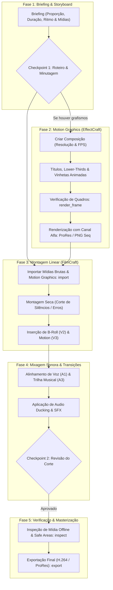

# ArtCraft: Vídeo, Edição & Motion Graphics
### Pipeline Integrado com EffectCraft & FilmCraft via MCP

Esta skill fornece uma metodologia completa, técnica e prática para agentes de IA atuarem na criação, animação, corte rítmico e masterização de produções audiovisuais para mídias digitais, streaming e redes sociais.

---

## 1. Matriz de Ferramentas e Papéis no Pipeline

| Aplicativo | Papel no Pipeline | Formatos Nativos / Exportados | Modo de Execução MCP | Equivalente de Mercado |
| :--- | :--- | :--- | :--- | :--- |
| **EffectCraft** | Composição avançada baseada em camadas, animação por quadros-chave (*keyframes*), vinhetas de abertura, terços inferiores (*lower-thirds*), legendas animadas, máscaras e efeitos visuais (VFX). | `.effectcraft`, `.aep`, sequências PNG, ProRes 4444 com Alpha | Headless (in-process engine) / Bridge (live UI) | Adobe After Effects / Apple Motion |
| **FilmCraft** | Edição linear e não-linear de linha do tempo (NLE), sincronização de faixas de áudio e vídeo, cortes rítmicos (*rough cut* e *fine cut*), inserção de mídias de apoio (*B-roll*), mixagem com *ducking* sonoro e renderização de master. | `.filmcraft`, `.prproj`, MP4 (H.264/HEVC), ProRes 422 | Headless (in-process engine) | Adobe Premiere Pro / DaVinci Resolve |

---

## 2. Convenções Técnicas e Parâmetros de Vídeo

### Resoluções, Proporções e Taxas de Quadros
- **Widescreen Paisagem (16:9):** $1920 \times 1080$ (Full HD) ou $3840 \times 2160$ (4K UHD) para YouTube, apresentações corporativas e TV.
- **Vertical Retrato (9:16):** $1080 \times 1920$ para Instagram Reels, TikTok, YouTube Shorts e Stories.
- **Quadrado (1:1):** $1080 \times 1080$ para posts de feed de redes sociais.
- **Taxa de Quadros (*Frame Rate*):**
  - $24\text{ fps}$: Look cinematográfico padrão para ficção e documentários.
  - $30\text{ fps}$: Padrão da internet, webcams, tutoriais e vídeos institucionais.
  - $60\text{ fps}$: Alta fluidez para captura de tela, games e movimentos esportivos rápidos.

### EffectCraft (`effectcraft`)
- **Unidades de Tempo:** Valores em segundos fracionários (ex.: $1.5\text{ s}$ corresponde a $1\text{ segundo}$ e meio).
- **Caminho de Propriedades (*Property Path*):** As propriedades de camadas são endereçadas hierarquicamente:
  - Transformação: `transform/position`, `transform/scale`, `transform/rotation`, `transform/opacity`.
  - Efeitos aplicados: `effects/#1/blurriness`, `effects/#2/intensity`.
- **Inspeção Rápida:** `render_frame` permite extrair um quadro PNG em um instante de tempo exato para inspeção visual sem necessidade de renderizar o vídeo completo.

### FilmCraft (`filmcraft`)
- **Organização de Faixas (*Tracks*):**
  - **Vídeo:**
    - `V1`: Câmera principal ou locução base (*A-roll*).
    - `V2`: Cenas complementares de apoio (*B-roll*), capturas de tela ou fotos.
    - `V3`: Elementos gráficos, títulos, lower-thirds e vinhetas transparentes do EffectCraft.
  - **Áudio:**
    - `A1`: Voz principal (diálogo ou locução).
    - `A2`: Efeitos sonoros (*SFX* e transições como *whoosh*, cliques).
    - `A3`: Trilha musical de fundo (*soundtrack*).
- **Níveis de Áudio Padronizados:**
  - Voz Principal: Entre $-6\text{ dB}$ e $-12\text{ dBFS}$.
  - Trilha de Fundo sob Diálogo (*Ducking*): Entre $-18\text{ dB}$ e $-24\text{ dBFS}$.
  - Limite Máximo de Segurança: Nunca exceder $-1\text{ dBFS}$ para evitar distorção e corte acústico (*clipping*).

---

## 3. Fluxo de Trabalho Integrado (Pipeline Visual)



---

## 4. Roadmap de Criação de Conteúdo: Passo a Passo

### 🎯 FASE 1: Briefing Audiovisual, Roteiro & Análise de Mídias
**Objetivo:** Definir o formato técnico, mensagem principal, ritmo do corte e catalogar as mídias disponíveis no projeto.

- **Ferramentas MCP / Sistema a Utilizar:** Comandos de inspeção do sistema de arquivos para verificar vídeos, áudios e imagens presentes na pasta de trabalho.
- **Perguntas Obrigatórias ao Usuário (Checkpoints):**
  1. *Formato & Destino:* "O vídeo será horizontal (16:9 Widescreen para YouTube) ou vertical (9:16 para Reels/TikTok/Shorts)?"
  2. *Duração Pretendida:* "Qual é a duração estimada ou teto máximo (ex.: 30 a 60 segundos para anúncio/reel, ou 5 a 10 minutos para vídeo explicativo)?"
  3. *Tom & Trilha Sonora:* "Qual o estilo sonoro desejado (enérgico, corporativo moderno, cinematográfico calmo, lo-fi relaxante)?"
  4. *Elementos Gráficos:* "Quais letreiros e títulos devem aparecer (nomes dos palestrantes, pontos-chave enumerados, chamada final para ação/CTA)?"
- **Quality Gate 1:** Obter a aprovação da minutagem estimada ou do roteiro de duas colunas (Áudio / Fala à esquerda $\times$ Vídeo / Visual à direita) antes de editar.

---

### 🎬 FASE 2: Criação de Motion Graphics no EffectCraft
**Objetivo:** Desenvolver os elementos visuais animados que conferem identidade e dinamismo à produção (vinhetas, lower-thirds e cartelas finais).

- **Ferramentas MCP a Utilizar:**
  - `effectcraft: command_run` com `comp.new` (criar composição com dimensões e framerate exatos).
  - `effectcraft: command_run` com `layer.newText` e `layer.newSolid` (criar camadas).
  - `effectcraft: set_property` (ajustar posições, escalas, rotações e cores).
  - `effectcraft: add_keyframe` (definir animações nos pontos de início e fim).
  - `effectcraft: render_frame` (gerar frame estático PNG para pré-visualização instantânea).
  - `effectcraft: command_run` com `render` (exportar a sequência de animação).
- **Ações Detalhadas:**
  1. *Terço Inferior (Lower-Third) de Identificação:*
     - Crie sólido ou retângulo com a cor da marca como fundo suave.
     - Insira texto principal ($24\text{pt}$ Bold) para o nome e texto secundário ($16\text{pt}$ Regular) para o cargo.
     - Anime a entrada de $0.0\text{s}$ a $0.5\text{s}$ com transição suave de opacidade e posição ($Y$ ou $X$).
     - Mantenha estático de $0.5\text{s}$ a $4.5\text{s}$.
     - Anime a saída de $4.5\text{s}$ a $5.0\text{s}$.
  2. *Cartela Final (Call to Action - CTA):*
     - Insira logotipo, endereço do site e instruções claras (ex.: "Inscreva-se no canal", "Acesse o link na bio").
- **Verificações Necessárias (Quality Gate 2):**
  - Chame `effectcraft: render_frame` no segundo $2.0$ para conferir a composição do lower-third.
  - Verifique se os textos respeitam as margens de segurança (*Safe Title Area* — manter todos os textos dentro de uma margem interna de $10\%$ das bordas da tela).

---

### ✂️ FASE 3: Montagem Linear da Linha do Tempo no FilmCraft
**Objetivo:** Importar as mídias, montar o corte seco do diálogo principal e enriquecer a narrativa com mídias de apoio.

- **Ferramentas MCP a Utilizar:**
  - `filmcraft: import` (importar clipes de vídeo, locuções, trilhas sonoras e renders do EffectCraft).
  - `filmcraft: exec` (inserir clipes nas faixas, definir pontos In e Out, cortar e fatiar trechos).
  - `filmcraft: inspect` (analisar o estado da sequência, verificar mídias e durações).
- **Ações Detalhadas:**
  1. *Corte Bruto (Rough Cut) no A-Roll (Faixa V1 & A1):*
     - Coloque a gravação principal na faixa V1 com áudio em A1.
     - Remova gagueiras, pausas mortas de respiração e erros de fala.
     - Garanta que a história flua de forma compreensível e cativante mesmo sem imagens adicionais.
  2. *Cobertura com B-Roll (Faixa V2):*
     - Posicione clipes de demonstração, capturas de tela e cenas secundárias sobre a fala na faixa V2 para ilustrar os conceitos mencionados.
  3. *Inserção de Grafismos (Faixa V3):*
     - Posicione as vinhetas e lower-thirds renderizados pelo EffectCraft sincronizados com os momentos exatos em que as pessoas são introduzidas.
- **Quality Gate 3:** Chame `filmcraft: inspect` e confirme que não há lacunas vazias ou buracos (*gaps*) involuntários entre clipes na faixa V1.

---

### 🎧 FASE 4: Pacing Rítmico, Transições & Mixagem Sonora
**Objetivo:** Polir a experiência sensorial, aplicando cortes em L/J, transições elegantes e balanceamento acústico rigoroso.

- **Ferramentas MCP a Utilizar:**
  - `filmcraft: exec` (aplicar transições de dissolução cruzada, cortes em J e L, e envelopes de volume de áudio).
- **Ações Detalhadas:**
  1. *Cortes em J e L:*
     - Utilize cortes em L (o áudio da cena anterior continua tocando sob a imagem seguinte) ou cortes em J (o áudio da próxima cena começa a soar $0.5\text{s}$ antes do corte de vídeo) para suavizar a transição entre assuntos.
  2. *Trilha Sonora & Ducking Automático (Faixa A3):*
     - Insira a música na faixa A3.
     - Ajuste o volume base da música para $-10\text{ dBFS}$ quando não houver voz.
     - Aplique atenuação (*ducking*) para $-22\text{ dBFS}$ durante todas as falas, retornando suavemente ao volume base quando a voz cessa.
  3. *Efeitos Sonoros de Destaque (Faixa A2):*
     - Insira efeitos suaves de *whoosh* ou *pop* sincronizados com a aparição de tópicos e lower-thirds.
- **Pergunta ao Usuário durante a Etapa (Checkpoint 2):**
  - "Finalizei a montagem rítmica e a mixagem sonora com duração total de [Duração, ex.: 1min 15s]. A dinâmica do corte e o volume da trilha musical estão no tom desejado ou prefere que a música fique mais sutil/enérgica?"

---

### 🔍 FASE 5: Quality Gates Técnicos, Masterização & Renderização
**Objetivo:** Realizar uma auditoria técnica completa e renderizar o vídeo final com os codecs e bitrates ideais.

- **Ferramentas MCP a Utilizar:**
  - `filmcraft: inspect` (verificar se há mídias offline ou parâmetros fora do padrão).
  - `filmcraft: export` (iniciar o render da timeline ativa).
  - `filmcraft: save_project` (gravar o arquivo de projeto mestre).
- **Checklist Rigoroso de Qualidade Audiovisual:**
  - [ ] **Mídia Offline:** Nenhuma mídia com status offline ou corrompida.
  - [ ] **Safe Areas:** Em vídeos verticais (9:16), todos os textos e botões estão fora das áreas cobertas pelas interfaces do Instagram/TikTok (topo superior de $150\text{px}$ e rodapé inferior de $250\text{px}$).
  - [ ] **Sincronia Labial (Lip Sync):** Áudio perfeitamente alinhado com o movimento dos lábios do interlocutor.
  - [ ] **Volume Master:** Nenhum pico ultrapassa $-1\text{ dBFS}$; a voz mantém clareza cristalina sem abafamento.
  - [ ] **Quadros Negros:** Ausência de *flash frames* pretos de $1$ frame decorrentes de cortes imprecisos.
- **Configurações de Exportação:**
  - **Distribuição Web / Social:** Formato MP4, Codec H.264 ou HEVC, Áudio AAC $320\text{ kbps}$, Taxa de bits de vídeo $12$ a $18\text{ Mbps}$ para 1080p.
  - **Arquivo Mestre (Master Archive):** Codec Apple ProRes 422 HQ ou Avid DNxHR para arquivamento sem compressão com perdas.
- **Verificação no Disco:** Utilize comandos do PowerShell para verificar o arquivo final (`Get-Item <video.mp4>`), certificando-se de que o tamanho do arquivo em megabytes é condizente com a duração.

---

## 5. Dicionário de Ferramentas MCP & Exemplos Práticos

### EffectCraft: Composição e Animação de Texto
```json
// 1. Criar composição Full HD de 5 segundos
{
  "tool": "effectcraft:command_run",
  "arguments": {
    "id": "comp.new",
    "params": {
      "name": "LowerThird_Director",
      "width": 1920,
      "height": 1080,
      "fps": 30,
      "duration": 5.0
    }
  }
}

// 2. Criar camada de texto
{
  "tool": "effectcraft:command_run",
  "arguments": {
    "id": "layer.newText",
    "params": {
      "name": "Name_Text",
      "text": "Dra. Carolina Mendes",
      "fontSize": 36,
      "fillColor": "#FFFFFF"
    }
  }
}

// 3. Adicionar Keyframe de Opacidade (Fade In)
{
  "tool": "effectcraft:add_keyframe",
  "arguments": {
    "layerId": "<id_da_camada>",
    "property": "transform/opacity",
    "time": 0.0,
    "value": 0
  }
}
{
  "tool": "effectcraft:add_keyframe",
  "arguments": {
    "layerId": "<id_da_camada>",
    "property": "transform/opacity",
    "time": 0.5,
    "value": 100
  }
}

// 4. Renderizar frame de teste para validação
{
  "tool": "effectcraft:render_frame",
  "arguments": {
    "time": 2.0,
    "outputPath": "renders/preview_frame.png"
  }
}
```

### FilmCraft: Importação e Exportação da Sequência
```json
// 1. Importar vídeo gravado e gráfico renderizado
{
  "tool": "filmcraft:import",
  "arguments": {
    "filePaths": [
      "raw_footage/interview_01.mp4",
      "renders/LowerThird_Director.mov",
      "audio/soundtrack_acoustic.mp3"
    ]
  }
}

// 2. Inspecionar estado da linha do tempo
{
  "tool": "filmcraft:inspect",
  "arguments": {
    "target": "activeSequence"
  }
}

// 3. Exportar vídeo final em H.264
{
  "tool": "filmcraft:export",
  "arguments": {
    "format": "h264",
    "preset": "YouTube_1080p",
    "outputPath": "exports/video_final.mp4"
  }
}
```

---

## 6. Tratamento de Erros e Resolução de Problemas (Troubleshooting)

| Sintoma / Erro | Causa Provável | Solução Recomendada |
| :--- | :--- | :--- |
| **Mídia com tarja vermelha ou status 'Offline'** | Arquivo de mídia foi movido ou renomeado após ter sido importado. | Execute `filmcraft:inspect` para identificar o clipe offline e use a ferramenta de relinkagem apontando o novo caminho. |
| **Letreiros cortados quando o vídeo é assistido no celular** | Elementos fora da margem de segurança de interfaces verticais (Safe Area). | Mantenha todos os títulos a pelo menos $150\text{px}$ de distância do topo e $250\text{px}$ de distância do rodapé em proporção 9:16. |
| **Áudio com chiado ou estalos agudos de distorção** | O volume da fala ultrapassou o teto digital de $0\text{ dBFS}$ (*clipping*). | Reduza o ganho da faixa A1 em $-3\text{ dB}$ ou aplique um compressor/limitador de pico com teto em $-1\text{ dBFS}$. |
| **Música abafando a voz do orador** | Falta de ducking sonoro ou volume da faixa A3 configurado muito alto. | Reduza a trilha de fundo na faixa A3 para pelo menos $-20\text{ dBFS}$ nos trechos em que a locução em A1 estiver ativa. |
